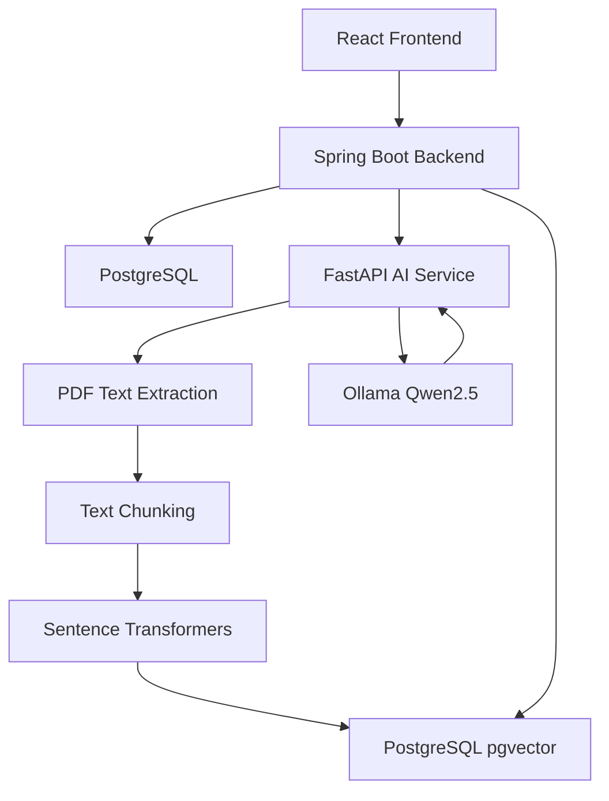

# 🧠 DocuMind AI
### AI-Powered Document Intelligence & Question Answering

An end-to-end, full-stack Retrieval-Augmented Generation (RAG) application that allows users to upload PDF documents, process their contents, and ask questions using locally running AI models.

DocuMind AI combines **Java Spring Boot**, **React**, **Python FastAPI**, **PostgreSQL with pgvector**, **Sentence Transformers**, and **Ollama** to provide context-aware answers grounded in uploaded documents.

The application demonstrates full-stack software engineering, AI integration, semantic search, vector databases, REST API development, and local large language model inference.

---

## 📌 Overview

Traditional document search relies heavily on keyword matching, making it difficult to retrieve information when users phrase questions differently from the source text.

DocuMind AI addresses this problem through semantic search and Retrieval-Augmented Generation.

Instead of simply searching for matching words, the system:

1. Accepts PDF document uploads.
2. Extracts text from uploaded PDFs.
3. Splits extracted text into manageable chunks.
4. Generates vector embeddings for each chunk.
5. Stores embeddings in PostgreSQL using pgvector.
6. Converts user questions into vector embeddings.
7. Retrieves relevant document chunks through vector similarity search.
8. Sends the retrieved context to a locally running large language model.
9. Generates a natural-language answer based on the document.

The goal is to make document exploration more intuitive, efficient, and accessible.

---

## ✨ Key Features

### 📄 PDF Document Management

- Upload PDF documents through a React interface.
- Validate uploaded files.
- Store document metadata in PostgreSQL.
- Maintain a list of uploaded documents.
- Select documents for processing and question answering.
- Delete documents and their associated embeddings.

### 🔍 Intelligent Document Processing

- Extract text from PDFs using PyMuPDF.
- Automatically divide extracted text into smaller chunks.
- Generate embeddings using Sentence Transformers.
- Store 384-dimensional vectors in PostgreSQL.
- Associate text chunks with their source documents.

### 🤖 AI-Powered Question Answering

- Ask questions in natural language.
- Generate embeddings for user questions.
- Retrieve semantically relevant document chunks.
- Use retrieved content as context for the language model.
- Generate answers through Ollama.
- Encourage document-grounded responses through prompt instructions.

### 💻 Full-Stack Interface

- Responsive React frontend.
- Document upload and management interface.
- Document processing controls.
- Interactive question-answering interface.
- Question-and-answer history within the application session.
- Loading indicators and error messages.

### 🔐 Local AI Processing

DocuMind AI uses a locally running Ollama model for answer generation.

This allows the application to perform LLM inference without requiring a paid cloud-based language model API.

---


## 🏗️ System Architecture





### Architecture Components

**Frontend — React**

Provides the user interface for uploading, processing, selecting, and querying PDF documents.

**Backend — Spring Boot**

Manages document metadata, file storage, REST endpoints, database operations, and communication with the Python AI service.

**AI Service — FastAPI**

Handles PDF text extraction, text chunking, embedding generation, and LLM-based answer generation.

**Vector Database — PostgreSQL + pgvector**

Stores document chunks and vector embeddings and supports semantic similarity search.

**LLM — Ollama**

Runs the Qwen2.5 3B model locally to generate natural-language answers using retrieved document context.

---

## 🛠️ Technology Stack

| Layer | Technologies |
|---|---|
| Frontend | React, JavaScript, Vite, CSS |
| Backend | Java 17, Spring Boot 4, Maven |
| AI Microservice | Python, FastAPI, Uvicorn |
| PDF Processing | PyMuPDF |
| Embeddings | Sentence Transformers |
| Embedding Model | all-MiniLM-L6-v2 |
| Vector Database | PostgreSQL, pgvector |
| LLM Runtime | Ollama |
| Language Model | Qwen2.5 3B |
| Database Access | Spring Data JPA, Hibernate |
| Communication | REST APIs, JSON, HTTP |
| Version Control | Git, GitHub |

---

## 🧠 Retrieval-Augmented Generation Pipeline

DocuMind AI uses a RAG pipeline consisting of two major stages.

### Stage 1: Document Ingestion

**Step 1 — Upload PDF**

The user uploads a PDF through the React frontend.

The Spring Boot backend validates the file, stores it locally, and saves its metadata in PostgreSQL.

**Step 2 — Extract Text**

Spring Boot sends the PDF to the FastAPI service.

PyMuPDF extracts the document's textual content.

**Step 3 — Chunk Text**

The extracted text is divided into smaller segments to support efficient retrieval.

**Step 4 — Generate Embeddings**

The Sentence Transformers model `all-MiniLM-L6-v2` converts each text chunk into a 384-dimensional vector.

**Step 5 — Store Vectors**

Document chunks and their embeddings are stored in PostgreSQL using pgvector.

### Stage 2: Question Answering

**Step 1 — Receive Question**

The user selects a processed document and submits a natural-language question.

**Step 2 — Embed Question**

The FastAPI service generates a vector representation of the question.

**Step 3 — Semantic Search**

Spring Boot queries pgvector to retrieve the most relevant chunks belonging to the selected document.

**Step 4 — Build Context**

The retrieved chunks are combined into a context passage.

**Step 5 — Generate Answer**

The context and question are sent to the Qwen2.5 3B model running through Ollama.

**Step 6 — Display Response**

The generated answer is returned through Spring Boot and displayed in the React frontend.

---

## 📁 Project Structure

```text
documind-ai/
│
├── ai-service/
│   ├── main.py
│   ├── chunking.py
│   ├── embeddings.py
│   ├── ollama_client.py
│   └── requirements.txt
│
├── backend/
│   ├── src/
│   │   ├── main/
│   │   │   ├── java/com/documind/backend/
│   │   │   │   ├── controller/
│   │   │   │   ├── model/
│   │   │   │   ├── repository/
│   │   │   │   ├── service/
│   │   │   │   └── BackendApplication.java
│   │   │   └── resources/
│   │   │       └── application.properties
│   │   └── test/
│   ├── pom.xml
│   ├── mvnw
│   └── mvnw.cmd
│
├── frontend/
│   ├── public/
│   ├── src/
│   │   ├── App.jsx
│   │   ├── App.css
│   │   ├── index.css
│   │   └── main.jsx
│   ├── package.json
│   └── vite.config.js
│
├── .gitignore
└── README.md
```

---

## ⚙️ Installation and Setup

### Prerequisites

Install the following:

- Java 17
- Python 3
- Node.js and npm
- PostgreSQL with pgvector
- Ollama
- Git

The application is currently configured for local development.

### 1. Clone the Repository

```bash
git clone https://github.com/prashmishah/documind-ai.git
cd documind-ai
```

### 2. Configure PostgreSQL

Create a database named `documind_db`.

Connect to the database using `psql` or a PostgreSQL client and enable the pgvector extension:

```sql
CREATE EXTENSION IF NOT EXISTS vector;
```

The application expects PostgreSQL at:

```text
127.0.0.1:5432
```

The default database configuration is defined in:

```text
backend/src/main/resources/application.properties
```

The database password is read from the `DB_PASSWORD` environment variable.

Spring Boot uses Hibernate to manage the application entities. PostgreSQL must have the pgvector extension installed and enabled before vector operations can work.

### 3. Install and Start Ollama

Install Ollama from:

https://ollama.com

Download the language model:

```bash
ollama pull qwen2.5:3b
```

Start the Ollama service if it is not already running:

```bash
ollama serve
```

The application expects Ollama at:

```text
http://127.0.0.1:11434
```

### 4. Start the Python AI Service

Open a PowerShell terminal:

```powershell
cd ai-service

python -m venv .venv

.\.venv\Scripts\Activate.ps1

python -m pip install -r requirements.txt

python -m uvicorn main:app --host 127.0.0.1 --port 8000
```

The service runs at:

```text
http://127.0.0.1:8000
```

FastAPI documentation is available at:

```text
http://127.0.0.1:8000/docs
```

The Sentence Transformers embedding model may be downloaded automatically during the first embedding request.

### 5. Start the Spring Boot Backend

Open another PowerShell terminal:

```powershell
cd backend

$env:DB_PASSWORD = Read-Host "PostgreSQL password"

.\mvnw.cmd spring-boot:run
```

The backend runs at:

```text
http://localhost:8080
```

Verify the backend health endpoint:

```text
http://localhost:8080/api/health
```

### 6. Start the React Frontend

Open a third PowerShell terminal:

```powershell
cd frontend

npm install

npm run dev
```

Open the frontend in your browser:

```text
http://localhost:5173
```

Vite proxies requests beginning with `/api` to the Spring Boot backend.

---

## 🔌 REST API Endpoints

### Spring Boot Backend

| Method | Endpoint | Description |
|---|---|---|
| GET | `/api/health` | Check backend availability |
| POST | `/api/documents` | Upload a PDF document |
| GET | `/api/documents` | Retrieve uploaded documents |
| POST | `/api/documents/{id}/extract` | Extract text and generate embeddings |
| POST | `/api/documents/{id}/ask` | Ask a question about a document |
| DELETE | `/api/documents/{id}` | Delete a document |

### FastAPI AI Service

| Method | Endpoint | Description |
|---|---|---|
| GET | `/health` | Check AI service availability |
| POST | `/extract-text` | Extract and chunk PDF text |
| POST | `/chunk-text` | Divide text into chunks |
| POST | `/generate-embeddings` | Generate text embeddings |
| POST | `/ask-question` | Generate a document-grounded AI answer |

### Example Question Request

```http
POST /api/documents/1/ask
Content-Type: application/json
```

```json
{
  "question": "What are the main objectives of this document?"
}
```

### Example Response

```json
{
  "documentId": 1,
  "question": "What are the main objectives of this document?",
  "answer": "The document describes its main objectives...",
  "model": "qwen2.5:3b",
  "chunksUsed": 5
}
```

The response shown above is illustrative; actual answers and the number of retrieved chunks depend on the selected document.

---

## 🖼️ Application Screenshots

Screenshots of the working application will be added here.

Suggested screenshots:

1. Document upload and management dashboard.
2. PDF processing interface.
3. AI-generated answer to a document question.

---

## 🔒 Security and Data Handling

- Database credentials are configured using an environment variable.
- Uploaded PDFs are excluded from Git version control.
- Python virtual environments and generated build files are excluded from Git.
- PDF uploads are validated using file extension and PDF signature checks.
- File uploads are limited to 10 MB through application configuration.
- LLM inference runs locally using Ollama.

**Note:** This is a local development and portfolio application, not a production-hardened document management platform. Authentication, authorization, advanced file security, and deployment protections would be needed before exposing it publicly.

---

## 🧪 Development Verification

The following functionality has been exercised during local development:

- PDF document upload.
- PDF text extraction.
- Text chunking.
- Embedding generation.
- Vector storage and similarity retrieval.
- Document-specific question answering.
- React frontend production build.
- Spring Boot backend compilation.

Additional automated integration and end-to-end tests are planned.

---

## 🚀 Future Improvements

Potential enhancements include:

- Multi-document question answering.
- Source citations and page references.
- User authentication and authorization.
- Conversation history stored in PostgreSQL.
- Streaming AI responses.
- OCR support for scanned PDFs.
- Docker-based deployment.
- Automated unit and integration testing.
- Cloud deployment.
- Improved retrieval evaluation and answer quality.

---

## 🎯 Engineering Concepts Demonstrated

This project demonstrates practical experience with:

- Full-stack application development.
- REST API design and integration.
- Java Spring Boot backend architecture.
- Python AI microservices.
- Retrieval-Augmented Generation.
- Natural language processing.
- Text embeddings and semantic similarity.
- PostgreSQL relational database design.
- Vector databases using pgvector.
- Local large language model inference.
- React frontend development.
- Git and GitHub version control.

---

## 👨‍💻 Author

**Prashmi Shah**

GitHub: https://github.com/prashmishah

Project Repository: https://github.com/prashmishah/documind-ai

---

## 📄 Project Status

**Status:** Functional local-development prototype.

The core PDF processing and document-specific AI question-answering workflow is implemented and working locally.

Further improvements will focus on testing, security, user experience, and deployment.
